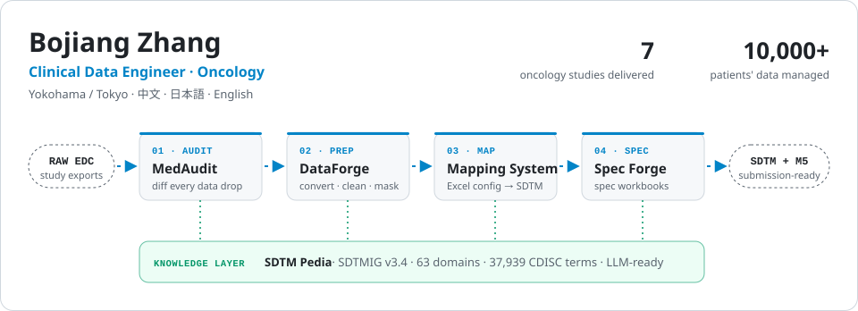
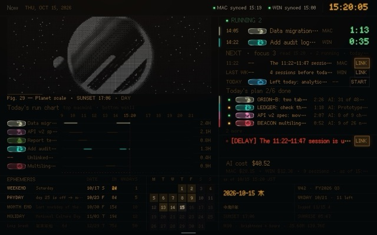

<a href="https://bojiang.org">
  <picture>
    <source media="(prefers-color-scheme: dark)" srcset="assets/hero-dark.svg">
    
  </picture>
</a>

I turn raw oncology study data into **CDISC SDTM** datasets, and build the tooling around that work.

**[bojiang.org](https://bojiang.org)** · Open to remote roles, and roles in Japan or Australia

### 🧬 The pipeline, repo by repo

| Stage | Project | What it does |
|---|---|---|
| Audit | [**MedAudit Diff Watcher**](https://github.com/hakupao/MedAudit-Diff-Watcher) | Watches versioned data drops; row- and field-level CSV diffs in an SQLite audit trail |
| Prep | [**DataForge Studio**](https://github.com/hakupao/tools_box) | Windows toolbox for conversion, cleaning and masking, for analysts who don't write Python |
| Map | [**SDTM Mapping System**](https://github.com/hakupao/SDTM-Mapping-System) | One Excel workbook drives a 7-step pipeline to SDTM datasets and an M5 package |
| Spec | [**SDTM Spec Forge**](https://github.com/hakupao/sdtm-spec-forge) | Rust CLI that writes dataset-spec workbooks against SDTMIG v3.4 and CDISC terminology |
| Knowledge | [**SDTM Pedia**](https://github.com/hakupao/sdtm-pedia) | 293 Markdown files · 63 domains · 37,939 CDISC terms, searchable by people and LLMs |

### 🔨 Now building

- A configuration-driven visual ETL platform for clinical data · Rust engine, Tauri + React desktop UI in design
- A web workspace for authoring and versioning SDTM transformation configs · React · FastAPI · SQLite

### 📅 Last week

<!-- weekly:start -->
Oct 12 – Oct 18, 2026 · refreshed every Monday from GitHub and <a href="https://github.com/hakupao/worklog-public">worklog</a>

- 🔒 548 contributions in private repos
- 🤖 53 AI agent sessions (Claude Code 44 · Codex 9) · 110 h of agent time over 4 days
<!-- weekly:end -->

### ▶️ Try it live

<table>
  <tr>
    <td width="33%" valign="top">
       
      <b><a href="https://github.com/hakupao/stoker">Stoker</a></b> 
      macOS scheduler that keeps Claude Code and Codex usage windows warm and logs quota snapshots
    </td>
    <td width="33%" valign="top">
       
      <b><a href="https://github.com/hakupao/worklog-public">worklog</a></b> 
      A work log that writes itself: AI agent sessions to weekly reports in JA / ZH / EN
    </td>
    <td width="33%" valign="top">
       
      <b><a href="https://github.com/hakupao/kana">Kana</a></b> 
      Hiragana, katakana or romaji readings for long Japanese text, entirely in the browser
    </td>
  </tr>
</table>

Also live: [**IT Passport Learning**](https://itlearn.bojiangz.com), a trilingual (JA / ZH / EN) study app for the Japanese IT Passport exam.

### 🛠️ Stack

<b>Beyond work</b>

 

- [**ShuttleArena**](https://shuttle-arena-demo.pages.dev): badminton tournaments with lottery draw, scheduling and real-time scoring
- [**Shuttle Path**](https://shuttle-path.pages.dev): badminton coaching knowledge base and illustrated lesson diaries
- [**LatSolar**](https://solar.bojiang.org): solar radiation by latitude, on an interactive 3D globe
- [**Exchange Atlas**](https://exchange.bojiang.org): live dashboard for six currency pairs across USD, CNY, JPY and AUD
- [**Japan property workbench**](https://loan.bojiang.org): loan simulation and rental yield analysis for Japanese real estate

中文 · 日本語 · English — [bojiang.org](https://bojiang.org) · [bojiangz.com](https://bojiangz.com)
