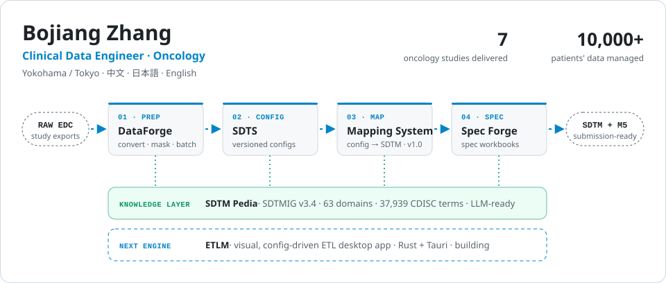
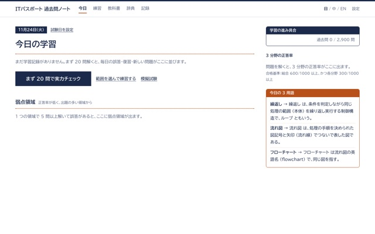
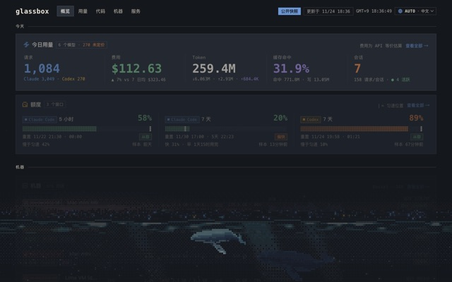
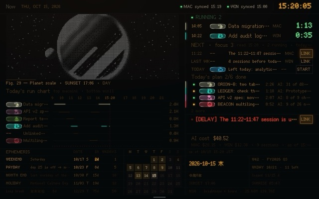
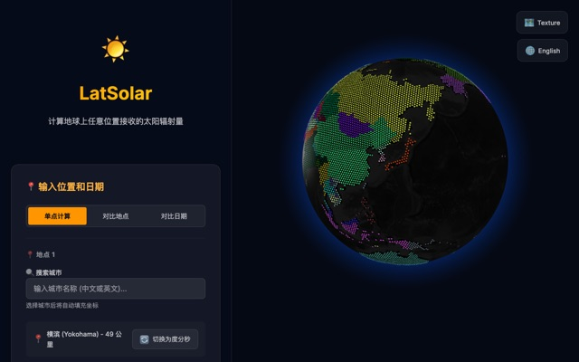

<a href="https://bojiang.org">
  <picture>
    <source media="(prefers-color-scheme: dark)" srcset="assets/hero-dark.svg">
    
  </picture>
</a>

I turn raw oncology study data into **CDISC SDTM** datasets and build the tooling around that work, with a team of AI coding agents writing most of the code.

**[bojiang.org](https://bojiang.org)** · Open to remote roles, and roles in Japan or Australia

### 🧬 The clinical data pipeline

| Stage | Project | What it does |
|---|---|---|
| Prep | [**DataForge Studio**](https://github.com/hakupao/tools_box) | Windows toolbox (v3, PySide6) for format conversion, data masking and batch EDC site entry, for analysts who don't write Python |
| Config | **SDTS** 🔒 | Web workspace for authoring and versioning SDTM transformation configs, in trial use on a private network · React · FastAPI · SQLite |
| Map | [**SDTM Mapping System**](https://github.com/hakupao/SDTM-Mapping-System) | One Excel workbook drives a 7-step pipeline to SDTM datasets and an M5 package. Took it over and refactored it to v1.0 (SQLite by default) |
| Spec | [**SDTM Spec Forge**](https://github.com/hakupao/sdtm-spec-forge) | Rust CLI that writes dataset-spec workbooks against SDTMIG v3.4 and CDISC terminology |
| Knowledge | [**SDTM Pedia**](https://github.com/hakupao/sdtm-pedia) | 293 Markdown files · 63 domains · 37,939 CDISC terms, plus a RAG + knowledge-graph service · [browse it live](https://sdtm-pedia.pages.dev) |

**Now building: ETLM** 🔒, a configuration-driven visual ETL platform for clinical data. A Rust workspace of 14 crates with a Tauri 2 + React desktop app; data prep, cleaning and terminology mapping work today, SDTM mapping and submission output come next.

Earlier: [MedAudit Diff Watcher](https://github.com/hakupao/MedAudit-Diff-Watcher), row- and field-level CSV diffs of versioned data drops in an SQLite audit trail.

### 🤖 How I work now

- **Agents as a team.** Claude Code writes most of the code, Codex gives a second, independent review, and Orca runs agents in parallel worktrees when a task splits.
- **A workflow sized to the job.** Small tasks run straight through. Bigger ones get a plan, a progress file, evidence and a retrospective. Any step that compresses or rewrites more than half of its input is spot-checked on independent samples. Failed attempts are archived, never deleted. A writer never reviews its own work.
- **Self-hosted.** Three Macs: one to develop on, a headless Mac mini that runs my self-hosted services, and one holding the Gitea primary with CI, mirrored to GitHub. All tied together over Tailscale.
- **Tools I built for it**:
  [**glassbox**](https://github.com/hakupao/glassbox), a cockpit for AI-assisted development across machines: usage, quotas, code activity and machine health, published as a sanitized snapshot ·
  [**Stoker**](https://github.com/hakupao/stoker), keeps Claude Code and Codex usage windows warm and logs quota snapshots ·
  [**worklog**](https://github.com/hakupao/worklog-public) (public edition), turns agent sessions into weekly reports in JA / ZH / EN ·
  [**hakupao-skills**](https://github.com/hakupao/hakupao-skills), agent skills I publish

### 📅 Last week

<!-- weekly:start -->
Nov 16 – Nov 22, 2026 · refreshed every Monday from GitHub and <a href="https://github.com/hakupao/worklog-public">worklog</a>

- 📦 Public commits: [**glassbox**](https://github.com/hakupao/glassbox) · 111, [**it-passport-learning**](https://github.com/hakupao/it-passport-learning) · 52, [**tools_box**](https://github.com/hakupao/tools_box) · 7
- 🔒 163 contributions in private repos
- 🤖 68 AI agent sessions (Claude Code 65 · Codex 3) · 108 h of agent time over 6 days
<!-- weekly:end -->

### ▶️ Try it live

<table>
  <tr>
    <td width="33%" valign="top">
       
      <b><a href="https://github.com/hakupao/it-passport-learning">IT Passport Learning</a></b> 
      Japan's IT Passport exam in JA / ZH / EN: 2,900 past questions, mock exams, a textbook and a glossary
    </td>
    <td width="33%" valign="top">
       
      <b><a href="https://github.com/hakupao/glassbox">glassbox</a></b> 
      My AI development, live: requests, cost, quotas and machines, as a sanitized public snapshot
    </td>
    <td width="33%" valign="top">
       
      <b><a href="https://github.com/hakupao/stoker">Stoker</a></b> 
      macOS scheduler that keeps Claude Code and Codex usage windows warm and logs quota snapshots
    </td>
  </tr>
  <tr>
    <td width="33%" valign="top">
       
      <b><a href="https://github.com/hakupao/shuttle-arena">ShuttleArena</a></b> 
      Full-stack badminton team tournaments: lottery draw, smart scheduling, scoring and standings
    </td>
    <td width="33%" valign="top">
       
      <b><a href="https://github.com/hakupao/worklog-public">worklog</a></b> 
      A work log that writes itself: AI agent sessions to weekly reports in JA / ZH / EN
    </td>
    <td width="33%" valign="top">
       
      <b><a href="https://github.com/hakupao/LatSolarLab">LatSolar</a></b> 
      Solar radiation for any place and date, on an interactive 3D globe · Three.js
    </td>
  </tr>
</table>

### 🛠️ Stack

<b>Beyond work</b>

 

- [**Kana**](https://kana.bojiang.org): hiragana, katakana or romaji readings for long Japanese text, entirely in the browser
- [**Hail**](https://hail.bojiangz.com): the life of a hailstone as a scrolling, animated story, in three languages
- [**Shuttle Path**](https://shuttle-path.pages.dev): badminton coaching notes: technique articles and an illustrated lesson diary
- [**Exchange Atlas**](https://exchange.bojiang.org): live dashboard for six currency pairs across USD, CNY, JPY and AUD
- [**Japan property workbench**](https://loan.bojiang.org): loan simulation and rental yield analysis for Japanese real estate
- Contributed: JIS 英数 / かな key support for [TriDog](https://github.com/aoyamashou/TriDog/pull/1), a trilingual input-source switcher

中文 · 日本語 · English — [bojiang.org](https://bojiang.org)
